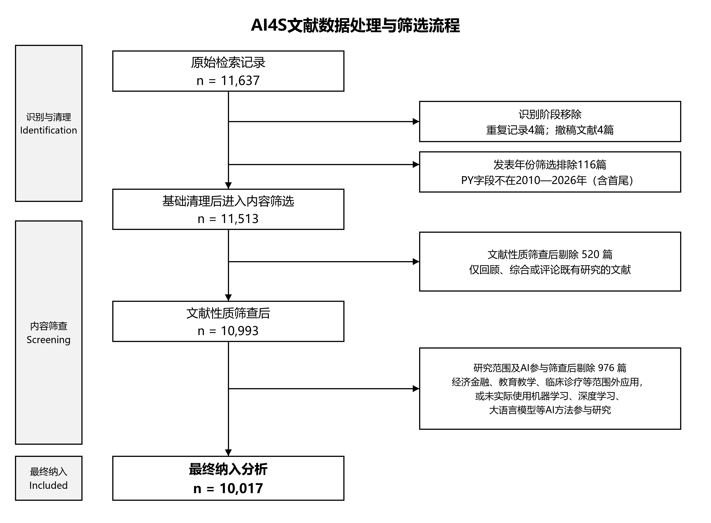
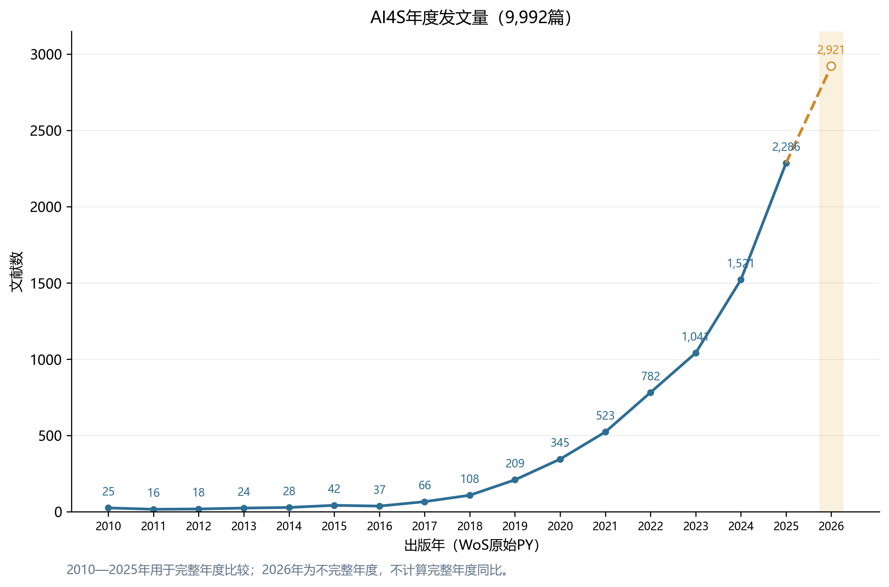
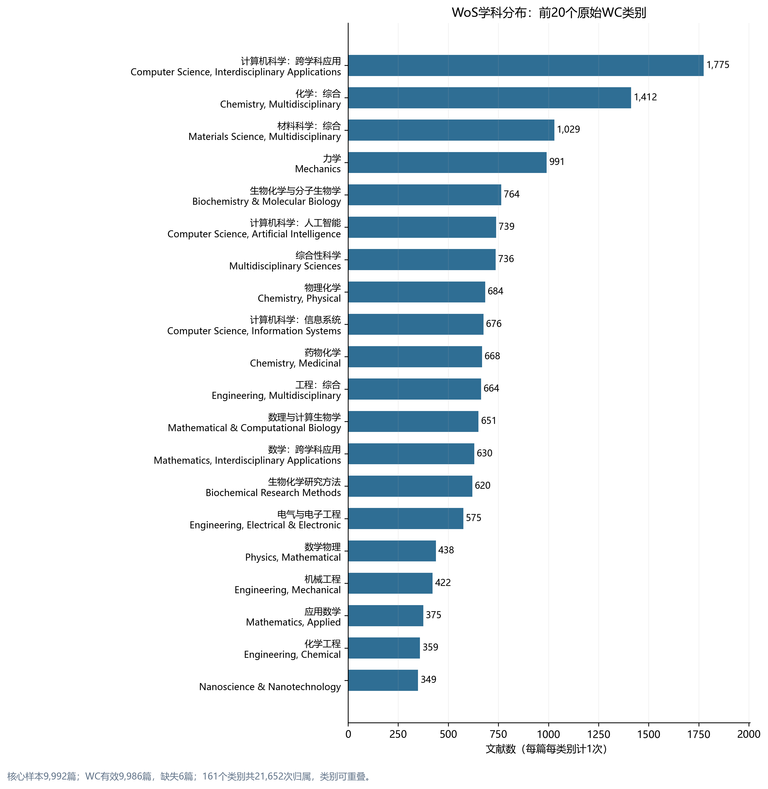
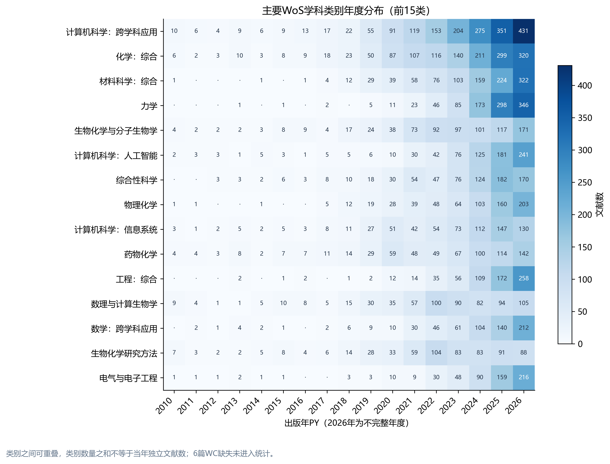
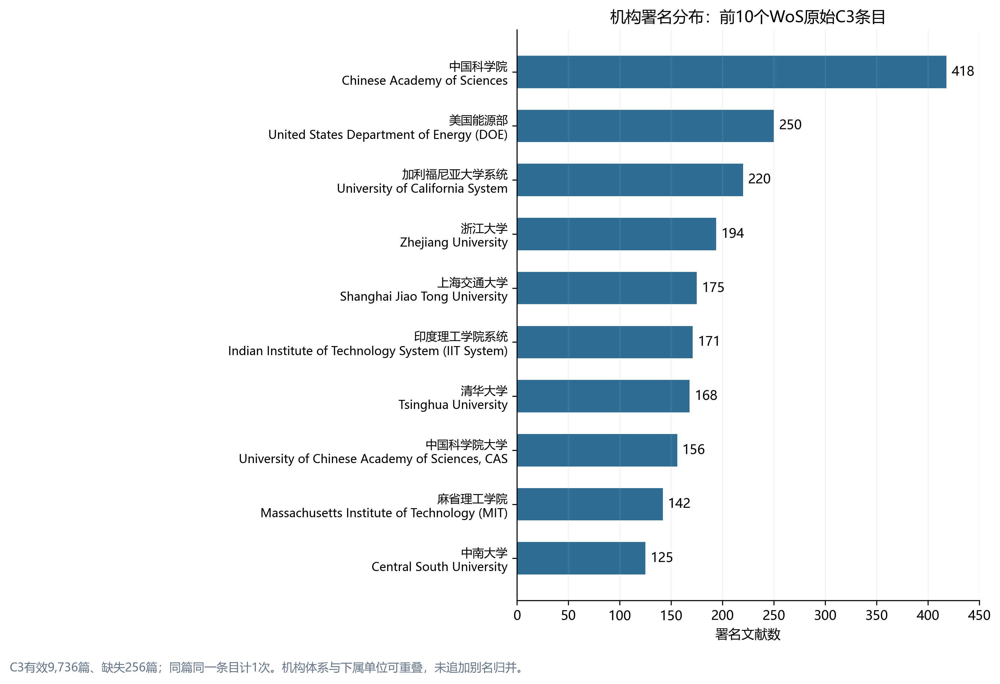

# 该数据库AI4S文献的筛选与基本统计结果概览

研究最终分析纳入文献 **10,017篇**。以下图表及配套数据均以该样本为基础，年度统计统一使用WoS出版年PY（Year Published出版年）。

## 筛选说明

原始候选文献共 **11,637条**。按最终结果归并的主线如下：

| 轮次 | 筛选内容与剔除依据 | 本轮剔除 | 剩余文献 |
| --- | --- | ---: | ---: |
| 第一步：基础筛选 | PY不在2010—2026年116篇；撤稿4篇；重复4条。 | 124 | 11,513 |
| 第二步：文献性质筛查 | 仅回顾、综合或评论既有研究的文献。 | 520 | 10,993 |
| 第三步：研究范围及AI参与筛查（含复核） | 经济金融、教育教学、临床诊疗等范围外应用，或未实际使用机器学习、深度学习、大语言模型等AI方法参与研究。 | 976 | **10,017** |

合计移除1,620条，其中基础清理124条、内容筛选1,496篇。各类别按最终结果互斥归并。纳入范围包括科学文献检索、知识提取、数据处理和科研编程等AI科研辅助应用。此前因科研辅助范围限制剔除的25篇已计入相应阶段的保留集合。

[本次最终裁决与历史衔接](reviews/2026-11-02_final/README.md) · [当前数据清单与数量核验](data/current_manifest.json)

## 筛选流程

[下载可编辑矢量流程图](figures/screening_flow.svg)

[筛选各轮数量数据](figures/source_data/screening_flow_counts.csv)

## 年度发文量

当前主分析全样本统一按WoS原始出版年PY（Year Published)统计年度发文量，最终10,017篇均有该字段。2010—2025年用于完整年度比较，2026年为不完整年度。

早期文献数据量较少，由于检索的相关范围，可能存在文献数据量的波动，总体来说，年度发文量呈现增长态势。2025年为2,289篇，2026年截至检索时为2,930篇；2026年是不完整年度，不据此计算完整年度同比增速。

[年度发文量数据（PY）](figures/source_data/annual_publications.csv) · [图表数据核验](data/figures_validation.json)

## 学科分布

按WoS原始WC(Web of Science Category)学科类别统计。10,017篇核心样本中，10,011篇有WC标注，涉及161个类别；6篇缺少WC字段，未计入学科统计。每篇文献在其所属的每个类别中各计1次，类别之间可重叠；合计21,703次学科归属，不等于独立文献总量。

上图展示文献数最多的20个WC类别，保留英文原名与中文对照。

热力图展示前15个WC类别在各年的文献数量，颜色越深表示数量越多；“·”表示该年该类别数量为零。类别之间可以重叠，各类别数量之和不能视为当年独立文献总量。2026年为不完整年度，解读时需注意。

[完整161类统计](figures/source_data/wc_category_counts.csv) · [各类别年度数据](figures/source_data/wc_annual_counts.csv) · [WoS字段说明](https://webofscience.help.clarivate.com/en-us/Content/export-records.htm)

## 机构分布

该图按照WoS原始C3（C3为文献数据中的机构字段）机构条目统计，同篇同一条目计一次。10,017篇文献中有9,759篇有C3标注，258篇缺少C3字段、未计入机构图。

[前10个机构条目及数量](figures/source_data/institution_top10.csv)

[统计图与汇总数据](figures) · [当前UT核对清单](data/retained_10017_ut.csv) · [检索词](检索词.md) · [返回首页](README.md)

