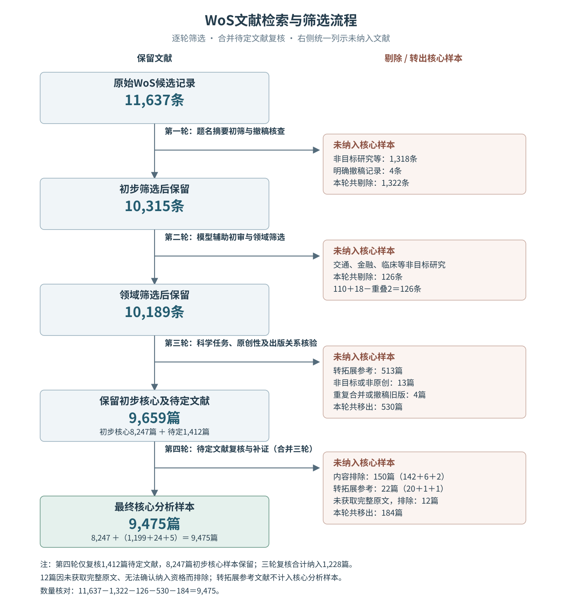
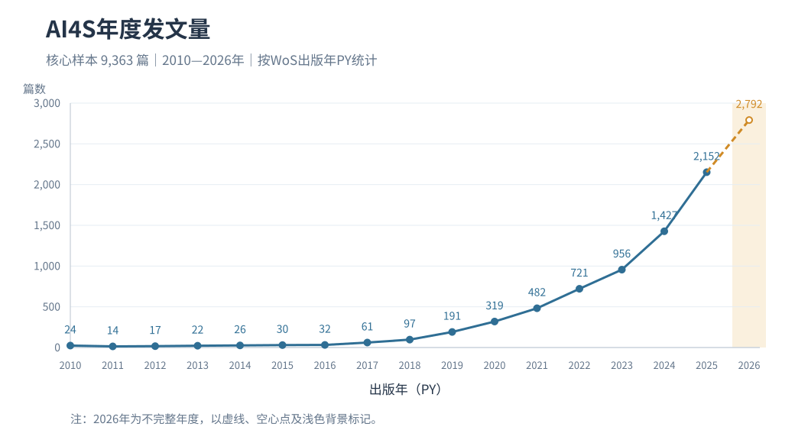
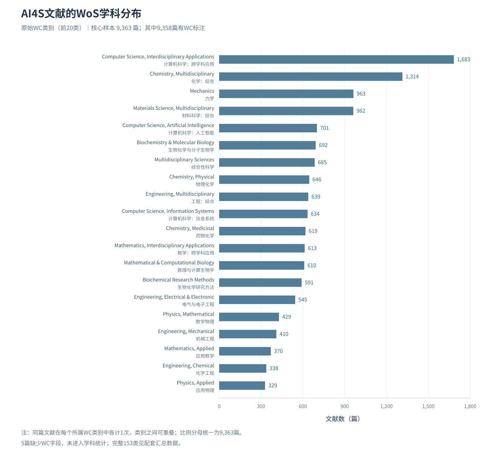
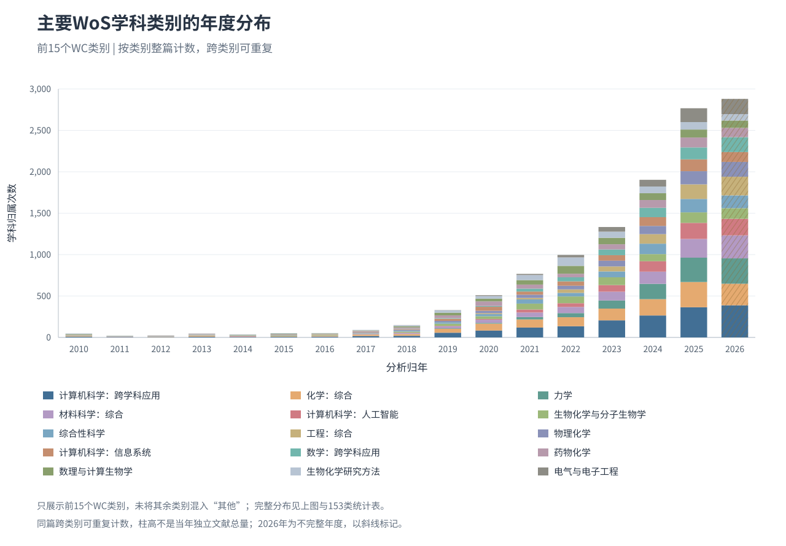
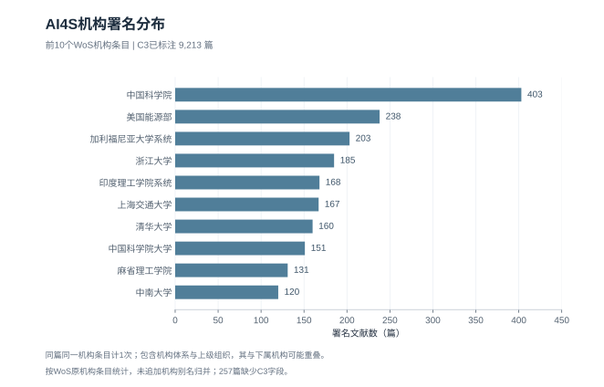

# AI4S 文献筛选与基本分布

经过数据筛选和处理，最终纳入文献数据 **9,475篇**。

## 筛选说明

| 轮次 | 筛选内容与剔除依据 |
| --- | --- |
| 第一轮：初步筛查 | 按题名、摘要与出版信息，剔除未见AI科学任务的研究、纯综述及其他非目标文献，移除明确撤稿记录。 |
| 第二轮：模型辅助初审与领域筛选 | 检查科学对象、AI方法与科研任务，标出疑点；剔除交通、金融、临床及其他非目标研究。 |
| 第三轮：内容与出版关系核验 | 核验科学任务和原创性，整理重复及撤稿旧版；一般数据、软件和平台支持材料列为拓展参考，待定文献单独复核。 |
| 第四轮：待定文献复核 | 复核1,412篇待定文献，依据AI方法、科学任务与原创研究证据，确定纳入、排除或转为拓展参考。 |
| 第五轮：补充证据核查 | 对51篇补查出版社、作者稿及公开方法资料，确定其中31篇的处置。 |
| 第六轮：剩余文献续核 | 对剩余20篇继续补查，纳入5篇、排除14篇、转拓展参考1篇。 |

## 筛选流程

## 年度发文量

按Early Access年份与正式出版年中较早的已记录年份归年。2026年为不完整年度，以虚线和空心点标记。

## 学科分布

按WoS原始WC类别统计。9,475篇核心样本中，9,470篇有WC标注，共涉及153个类别；5篇缺少WC字段，未计入学科统计。每篇文献在其所属的每个类别中各计1次，类别之间可重叠。

上图展示文献数最多的20个WC类别，保留英文原名与中文对照。

堆叠图展示前15个WC类别的年度变化，不将其余类别合并为“其他”。柱高为所示类别的归属次数之和，不能视为当年独立文献总量；2026年为不完整年度，以斜线标记。

[完整153类统计](figures/source_data/wc_category_counts.csv) · [各类别年度数据](figures/source_data/wc_annual_counts.csv) · [WoS字段说明](https://webofscience.help.clarivate.com/en-us/Content/export-records.htm)

## 机构分布

按WoS原机构条目统计，同篇同一条目计一次。机构体系与下属单位可能同时出现，数值不相加；258篇缺少相关的机构来源，未计入此图。

[统计图与汇总数据](figures) · [文献TXT下载](https://github.com/lingfyou-code/AI4Sdatabase/releases/download/data-v4-20261023/AI4S_9475_WoS_TXT.zip) · [检索词](检索词.md) · [返回首页](README.md)
